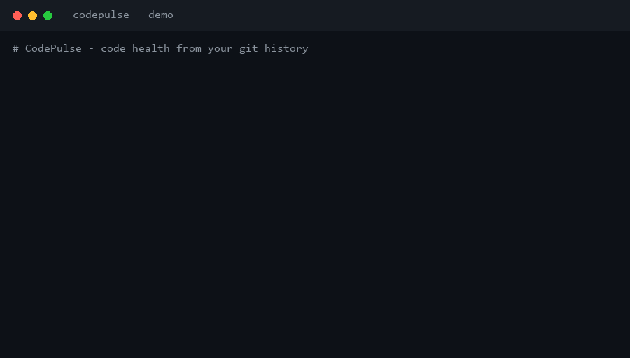

# 🩺 CodePulse

[](https://github.com/marketplace/actions/codepulse-risk-gate)
[](https://github.com/Mehouelley/codepulse/actions/workflows/tests.yml)
[](https://www.python.org/)
[](LICENSE)
[](pyproject.toml)

**Reveal a codebase's health from its git history.**

Linters read your code. CodePulse reads your code's *history* — and that reveals
things no linter can see: where bugs are born, what knowledge lives in one
person's head, and which files are secretly glued together.

Because it works purely from git history, **CodePulse works on any language**,
with **zero dependencies** beyond git and Python.

---

## Demo



```console
$ codepulse . --badge
Grade: B (83/100)

$ codepulse . --changed origin/main
Release risk: HIGH (100/100)
   [100] crates/ui-egui/src/lib.rs   (major hotspot)
   Reviewers: Valentin Klein (29/37), Dmitrii Khlapov (22/37)

$ codepulse . --who crates/ui-egui/src/canvas.rs
canvas.rs — 64 commits, 22 authors — 45% Valentin Klein
```

> The GIF is generated from [`demo.tape`](demo.tape) ([VHS](https://github.com/charmbracelet/vhs)).

---

## What it shows

| Signal | Question it answers |
|---|---|
| 🔥 **Hotspots** | *Where do I refactor first?* Files that are both complex and changed constantly — the birthplace of most bugs. |
| 👥 **Bus factor** | *What breaks if someone leaves?* Files actively maintained by a single person. |
| 🔗 **Hidden coupling** | *What really depends on what?* Files that almost always change together, even when the code doesn't show a link. |
| 🏆 **Contributors** | Who is active across the analyzed window. |

The result is a single self-contained **HTML dashboard** you can open anywhere
or email to your team.

---

## Install

```bash
pip install codepulse-cli    # installs the `codepulse` command
```

## Quick start

```bash
pip install codepulse-cli
codepulse /path/to/repo --open      # full HTML health dashboard
```

> No `codepulse` command found? Use `python -m codepulse ...` with the same
> arguments, or add Python's user `Scripts` directory to your `PATH`.

## Commands

CodePulse has **four modes**. The first argument is always the repo path
(default: `.`).

### 1. Report — the full dashboard (default)

Recommendations, hotspots, bus factor, coupling, trend, orphaned code — as a
self-contained HTML page.

```bash
codepulse .                        # writes codepulse-report.html
codepulse C:\path\to\project --open
```

### 2. Risk gate — score a change (`--changed`)

Scores only the files a change touches, for CI. Sets an exit code so a pipeline
can warn or block.

```bash
codepulse . --changed origin/main --fail-on HIGH
codepulse . --changed HEAD~5 --format markdown   # ready-to-post PR comment
```

### 3. Who knows this file? (`--who`)

Ranks who understands a file best, from git history (accepts a partial path).

```bash
codepulse . --who src/App.tsx
```

### 4. Health badge (`--badge`)

An A–F health grade plus a shields.io snippet for your README.

```bash
codepulse . --badge
```

## Options

| Flag | Meaning |
|---|---|
| `repo` | Path to a git repository (default: current directory) |
| `-o, --output FILE` | Report output path (default: `codepulse-report.html`) |
| `--open` | Open the HTML report in a browser when done |
| `--top N` | Rows per table (default: 20) |
| `--since "6 months ago"` | Only commits after this date |
| `--max-count N` | Limit to the N most recent commits |
| `--ignore GLOB` | Exclude paths matching a glob (repeatable) |
| `--no-default-ignore` | Keep generated/data files (locks, images, fonts, `node_modules`, …) |
| `--who PATH` | Who knows a file best, then exit |
| `--badge` | Print a health-badge snippet, then exit |
| `--changed REF` | Risk-gate mode: score files changed since REF |
| `--format text\|json\|markdown` | Risk-gate output format (default: `text`) |
| `--fail-on LOW\|MEDIUM\|HIGH` | Exit non-zero when risk reaches this level |

---

## CI integration

The **risk gate** (mode 2 above) is built for CI: `--fail-on` sets the exit
code, and `--format json` feeds dashboards and PR comments.

JSON output:

```json
{
  "level": "HIGH",
  "score": 100,
  "high_risk_count": 1,
  "files": [
    { "path": "auth.py", "risk": 100, "commits": 6, "loc": 7,
      "reasons": ["hotspot majeur", "auteur unique (Alice)"] }
  ]
}
```

### GitHub Action (two lines)

Add CodePulse to any repository as a reusable Action — it scores each PR, posts
a **sticky comment** (updated in place, never spammed), and fails the check on
`HIGH` risk:

```yaml
name: CodePulse
on: pull_request
permissions:
  contents: read
  pull-requests: write
jobs:
  risk:
    runs-on: ubuntu-latest
    steps:
      - uses: actions/checkout@v4
        with: { fetch-depth: 0 } # full history is required
      - uses: Mehouelley/codepulse@v0.1.0
        with:
          fail-on: HIGH # or MEDIUM / LOW / '' to never fail
```

The PR comment looks like:

> 🩺 **CodePulse — Risque : 🔴 HIGH (100/100)**
> 38 fichiers modifiés · 1 à risque élevé
>
> 👥 **Relecteurs suggérés** : Valentin Klein (29/37 fichiers), Dmitrii Khlapov (22/37)

Prefer a plain workflow with no external action? One ships in
[`.github/workflows/codepulse.yml`](.github/workflows/codepulse.yml) — copy it in as-is.

**Why DevOps cares:** a release is roughly as risky as its riskiest file.
Touching a well-known hotspot — or a file only one person understands — is
exactly where change-failure-rate (a DORA metric) comes from. The gate makes
that risk visible *before* merge, not after an incident.

---

## How it works

1. Parses `git log --numstat` into commits and file changes (no merges).
2. Accumulates per-file history: commit count, authors, size on disk.
3. Derives the signals:
   - **Hotspot score** = `commits × complexity`, where complexity estimates
     decision points (branch keywords + boolean operators) — far better than
     raw line count at telling "big but simple" from "dense and risky".
   - **Bus factor risk** = files with ≥3 commits but exactly one author.
   - **Coupling degree** = `commits-together / min(individual commits)`,
     ignoring bulk commits that touch many files at once.

Inspired by the "code as a crime scene" approach to software analysis, made
simple enough to run in one command.

---

## Roadmap

- [x] Risk gate: score a change set, JSON output, CI exit code
- [x] Ignore globs / path filters for generated & data files
- [x] Post the gate result as a sticky PR comment (GitHub Action)
- [x] Trend over time (adaptive day/week/month buckets + hotspot-pressure verdict)
- [x] Complexity-based hotspots (decision-point estimate instead of line count)
- [x] Suggested PR reviewers from code ownership (in gate text/json/comment)
- [x] `--who <file>` — who knows this code best
- [x] `--badge` — shareable A–F health badge for your README
- [x] Orphaned-code section — complex files nobody touches anymore
- [x] **Recommendations** — prioritized, concrete actions, not just findings

## Development

```bash
pip install -e ".[dev]"
pytest
```

The suite covers the complexity estimator, git parsing, every analyzer, and an
end-to-end run against a throwaway git repo. CI runs it on Python 3.10 and 3.12.

## License

MIT
